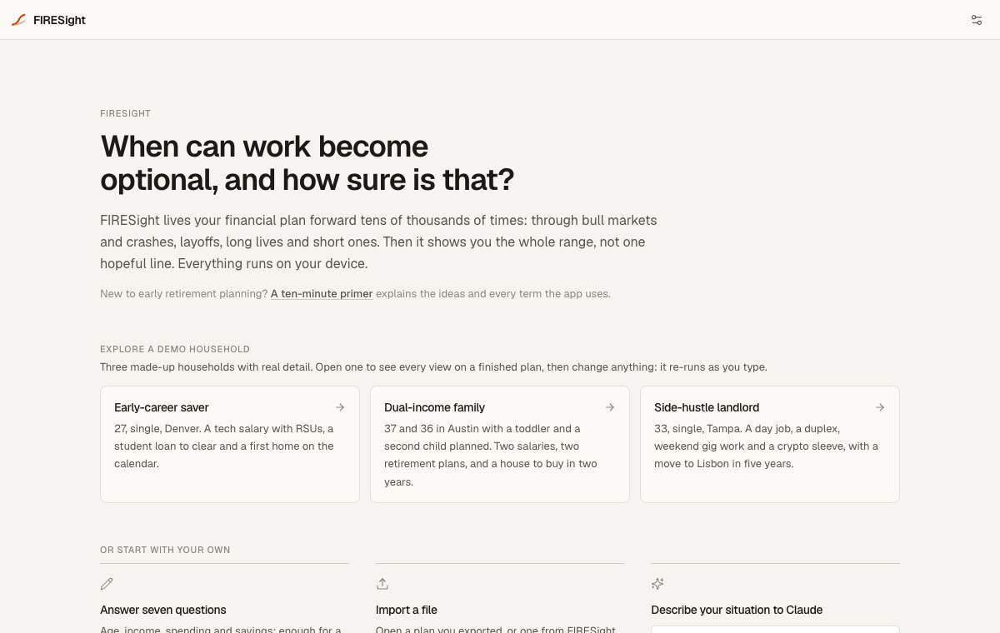
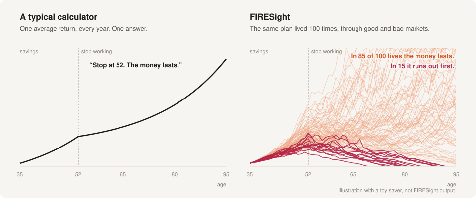
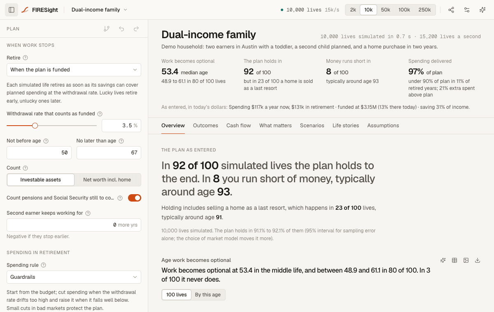
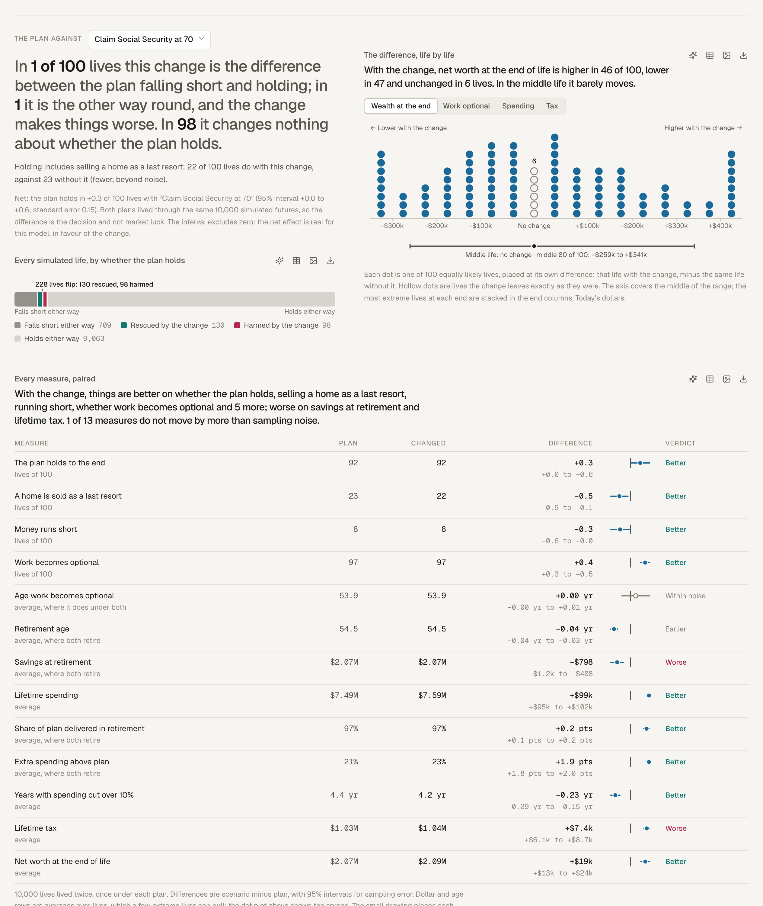
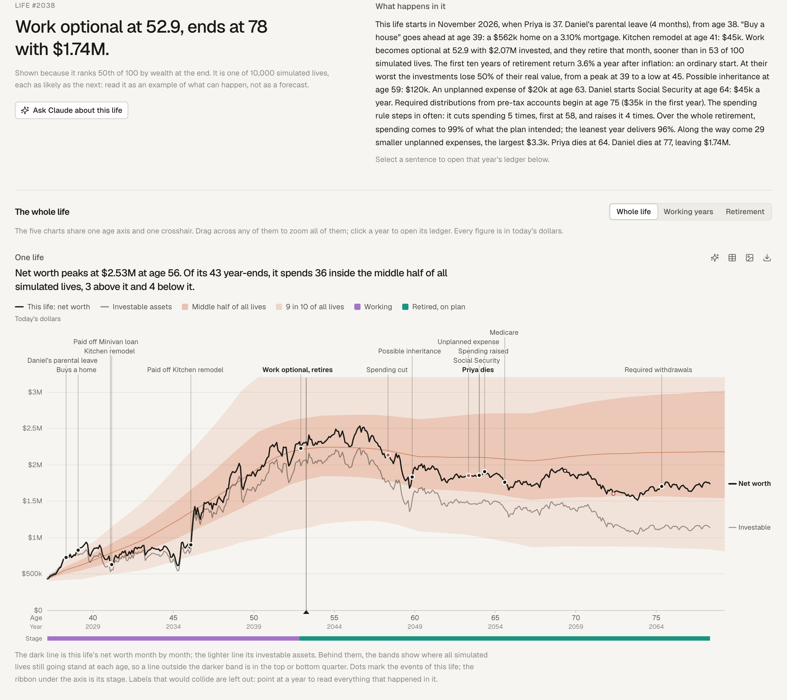
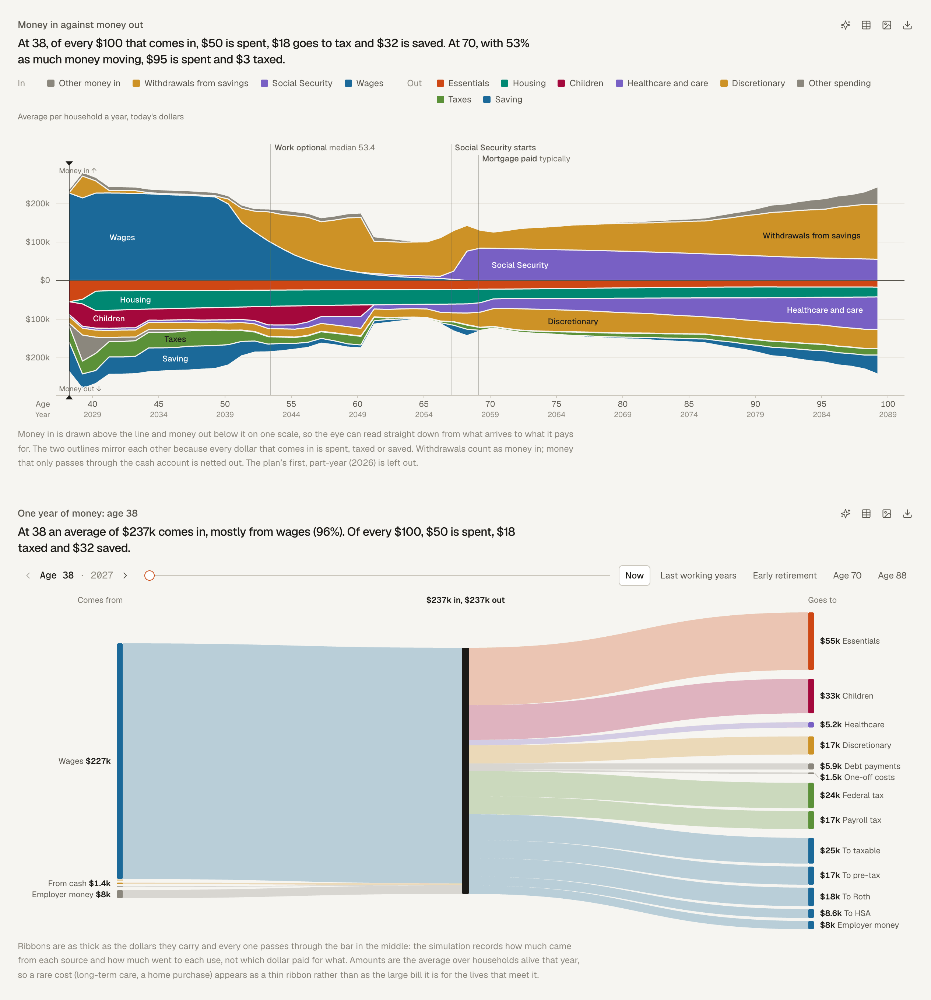
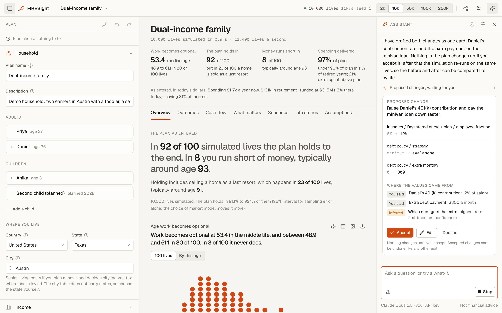

<h1 align="center">FIRESight</h1>

<p align="center">
  <strong>When can work become optional, and how sure is that?</strong><br>
  A retirement planner that lives your financial life forward 100,000 times, in your browser, in about six seconds.
</p>

<p align="center">
  <a href="https://firesight-v2.vercel.app"><strong>Try it: firesight-v2.vercel.app</strong></a> ·
  <a href="docs/primer.md">New to FIRE? Start here</a> ·
  <a href="docs/methodology.md">How the model works</a> ·
  <a href="#run-it-yourself">Run it yourself</a>
</p>

<p align="center">
  <a href="https://github.com/joey12725/firesight-v2/actions/workflows/ci.yml"></a>
  
  
  <a href="LICENSE"></a>
</p>

<p align="center">
  
</p>

<p align="center"><sub>Opening a demo household. The first picture appears in under a second and sharpens as 100,000 lives arrive. Every number on screen is real engine output.</sub></p>

Nothing to install, no account, and your numbers never leave your browser.

---

## What is this?

**FIRE** (*Financial Independence, Retire Early*) is a movement of people who save and invest a large share of their income until their investments can pay for their life. From then on, work is optional. Everyone doing this eventually asks the same three questions: how much is enough, when will I get there, and how sure is that?

Most calculators answer the first two with a single line. They assume the market earns its average every year, multiply, and give you a date. Real markets give the average in a jumbled order. A crash in the first years after you stop working can sink a plan that the average said was fine.

<p align="center">
  
</p>

FIRESight answers the third question. It simulates your whole household month by month: careers with raises and layoffs, children, a mortgage, real 2026 tax law, health insurance before Medicare, Social Security computed from your earnings, and an actuarial lifespan. It does this tens of thousands of times, each time through a different stretch of real market history. Then it counts what happened.

> **Never heard of the 4% rule, a Roth ladder or sequence risk?** The **[primer](docs/primer.md)** explains everything FIRESight assumes you know, in about ten minutes, with a glossary of every term in the app.

## Try it in a minute

1. Open **[firesight-v2.vercel.app](https://firesight-v2.vercel.app)** and pick one of the four demo households, all made up but realistic.
2. Read the four numbers at the top: the age work becomes optional, how many lives in 100 the plan holds, how many run short, and how much of the planned spending was actually delivered.
3. Change something in the plan editor on the left. Everything re-runs as you type.

<p align="center">
  
</p>

<p align="center"><sub>The trade-off at the centre of early retirement, live. A higher <em>withdrawal rate</em> means planning to spend a bigger share of savings each year. Work becomes optional sooner, and the plan holds in fewer lives.</sub></p>

To try your own numbers, use the seven-question guided setup or describe your situation to the built-in Claude assistant.

## What you get

**The headline.** Each answer is a count over simulated lives, with its uncertainty. "The plan holds in 92 of 100 lives (95% interval 91.5 to 91.9)" comes with how often holding meant selling the house, and how much of your planned spending was actually delivered. A plan that survives by cutting your spending 40% is not reported as a plain success.

<p align="center"></p>

**Eight views**, each built around one question, with a plain-English sentence above every chart:

| View | Question |
|---|---|
| Overview | When does work become optional, and how sure is that? |
| Outcomes | How wide is the range of lives, and what separates the good from the bad? |
| Cash flow | Where does the money come from and go, at every age? |
| Equity | What could my startup stock and options pay, and does the plan hold if they pay nothing? |
| What matters | Which of my decisions move the result, and which risks are out of my hands? |
| Scenarios | What does one change do, on exactly the same set of futures? |
| Life stories | What does one of these lives actually look like? |
| Assumptions | What does the model believe about the world? |

**Startup equity.** The plan editor has a section for stock, options and RSUs in private companies. You enter what your grant letter and equity portal say, plus how far along the company is, and a preview shows 100 equally likely futures for the position: how many pay nothing, and how wide the rest are. The Equity view, which appears for a plan with such holdings, shows what the position does to the plan. Results are given as modelled and with the equity counted at zero on the same simulated lives, and split by whether the company fails, is acquired or goes public. Paper value is reported and never counted as money.

<details>
<summary><strong>See the views</strong> (screenshots)</summary>

**What matters.** Every lever is tested on the same simulated lives and ranked by what it does to your result. Levers are split into what you control and what the world decides, and each bar carries its uncertainty. Below it is a map of two decisions at once, and a solver that finds the number you're looking for.

<p align="center"></p>

**Scenarios.** Both versions of your plan live the same lives. The comparison can therefore count the lives where the change decides between running short and not, and the ones where it backfires.

<p align="center"></p>

**Life stories.** Pick one life (an unlucky one, a middling one, one that ran short) and read it. The layoff during the crash, the Roth conversions, the year the guardrail cut spending, and the tax return for 2041 are all there.

<p align="center"></p>

**Cash flow.** Where the money comes from and where it goes at every age, and a flow diagram for any single year.

<p align="center"></p>

**Outcomes**, in the dark theme. Every chart has a data table behind it, PNG and CSV export, and works on a phone.

<p align="center"></p>

</details>

## What it models

Terms in this section are explained in the [primer's glossary](docs/primer.md#glossary).

- **A whole household, not a portfolio.** It handles two earners, children with childcare and college, homes and rentals, and debts. Life events can have a probability and a fuzzy date ("we might inherit around 2040"). There are seven kinds of income and five kinds of account.
- **An economy that hangs together.** Stocks, bonds, cash, inflation, mortgage rates, home prices and recessions are resampled jointly from 1,200 months of US history (1926 to 2026). A 1970s-style stagflation therefore hits your bonds, your raise and your grocery bill at once. Three other market models are one click away, including a straight replay of every historical start date.
- **Real tax law.** The model covers federal brackets, capital gains, the Social Security "tax torpedo", payroll tax, the child credit, the SALT cap, 51 state systems and the big city taxes, all indexed to simulated inflation. Early retirees get the ACA health-insurance subsidy, and the withdrawal planner steers around the income level where the subsidy stops.
- **Retirement as people actually do it.** It includes Roth conversion ladders, 72(t) payments, required distributions and tax-aware withdrawal ordering. Six spending rules from the research literature are built in, among them constant real, Guyton-Klinger guardrails, Vanguard dynamic and VPW.
- **Startup equity.** Options, RSUs and shares in private companies with uncertain outcomes: the company fails, is acquired, goes public, or stays private for years. The model covers exercise cost, the alternative minimum tax and its credit, tender offers and IPO lockups.
- **Risks that aren't the market.** Job loss clusters in recessions. The model also covers health costs and a possible long-term-care episode late in life, and it draws each lifespan from actuarial tables instead of assuming everyone lives to 95.
- **Paired experiments.** Change one decision and the same 100,000 futures are lived again with only that difference. The comparison measures your decision, not luck.
- **A grounded Claude assistant.** It can build your plan from a description or a pay stub and run the simulator to answer what-if questions. It cannot quote a number it didn't get from the engine.

## Ask Claude

<p align="center"></p>

The assistant has twelve tools, and every one of them calls the engine. It can read the plan, propose changes, run a simulation, try a scenario on the same lives, rank the levers, solve for a target, sweep a grid, open one life and explain a tax return. It proposes edits as cards you accept or decline. It lists what it assumed separately from what you told it, and every answer carries a "based on" strip showing the runs behind it.

You can bring your own Anthropic API key, which stays in your browser and goes only to Anthropic. Alternatively, set `ANTHROPIC_API_KEY` on your own deployment to host the assistant for visitors. Everything else works without it. [docs/assistant.md](docs/assistant.md) has the details and covers exactly what leaves the browser.

## Is the model any good?

It was built to be checked. Some of what has been checked:

- **The 4% rule falls out.** Take a retiree with $1M in a 60/40 portfolio spending $40,000 a year for 30 years. Replayed from every start month since 1926, the plan survives 96.0% of the time. The failures are exactly the 1965 to 1969 retirees, as in the published studies.
- **Money is conserved.** Three accounting identities are asserted every simulated month in test mode, across every market model and a household that exercises every feature.
- **A closed-form check.** A riskless saver matches a spreadsheet calculation to within $2 over ten years.
- **Scenarios are paired exactly.** Changing your spending leaves every market return, layoff and death date bit-identical, and tests check this.
- **Seven independent audits.** Tax, the ledger, retirement decisions, the economy, people and careers, housing, and performance were each reviewed by a separate auditor required to reproduce every claim. They found 3 critical and 20 major defects. All 23 were fixed, nearly all with a regression test.
- **What the audits did not cover.** Startup equity, the alternative minimum tax and its credit, and the small-business stock exclusion were added after these audits. They are covered by their own tests and hand-checked tax examples ([methodology](docs/methodology.md) sections 5 and 6.1), not by the audits.

**[docs/methodology.md](docs/methodology.md)** explains the model relationship by relationship. It gives the equations and the measured return distributions, and lists without softening what the model leaves out.

Three default settings are judgement calls that move headline numbers by several points:

1. US stock returns are cut by 1.5 points a year against the historical record, because one country's lucky century is a poor forecast.
2. Crypto is assumed to have no expected real return.
3. A home is sold as a last resort before a household is counted as broke.

You can change all three in the settings.

## How fast

These figures are from a 10-core Apple M-series laptop, simulating the two-earner demo household (a 63-year plan of about 680 months per life):

| | Lives per second | 100,000 lives |
|---|---|---|
| Browser (9 web workers, wasm) | 17,500 | 5.7 s |
| CLI, 10 threads | 32,800 | 3.1 s |
| CLI, 1 thread | 5,700 | 17.7 s |

The speed shows up in the answers. At 1,000 lives, a 5% failure rate has a sampling uncertainty of about ±1.4 points, enough to make two versions of a plan look different when they aren't. At 100,000 lives it is ±0.14. The first picture appears about 85 ms after you change a field. Charts hold 60 fps while a quarter of a million lives are running. The same seed gives byte-identical results in the browser, on the command line, and across any number of threads.

---

## Run it yourself

### Prerequisites

| Tool | Version | Check |
|---|---|---|
| [Rust](https://rustup.rs) | stable, plus the `wasm32-unknown-unknown` target | `rustc --version` |
| [Node.js](https://nodejs.org) | 22 or newer | `node --version` |

`wasm-pack` comes with the web app's npm dependencies, so you don't need to install it separately.

### The web app

```bash
git clone https://github.com/joey12725/firesight-v2 && cd firesight-v2
rustup target add wasm32-unknown-unknown

cd web
npm install
npm run prepare-engine   # compile the engine to WebAssembly, generate TypeScript types, copy data
npm run dev
```

Open <http://localhost:5173> and pick a demo household. If you change Rust code, run `npm run prepare-engine` again.

### The command line

The same engine runs natively, with all your cores:

```bash
cargo build --release -p firesight-cli
alias firesight=./target/release/firesight

firesight run examples/dual-income-family.json --paths 100000
```

```
Dual-income family (start 2026-11, seed 1)
paths                  100000
success rate           91.7%  (95% interval 91.5% to 91.9%)
depletion risk         8.3%  (median age when it happens 92.6)
financially independent 96.7% of paths; age p10 49.0 / p50 53.4 / p90 61.2
retirement age         p10 50.0 / p50 53.4 / p90 61.2
spending delivered     97.0% of plan on average; 43.5% of retired paths had a year below 90%
terminal net worth     p10 $133,167 / p50 $1,761,075 / p90 $4,071,800
lifetime tax (median)  $962,458
failed paths, first cause: Health 89.3%, MarketSequence 6.1%, JobLoss 1.9%, Overspending 1.4%
32802 paths/s on 10 thread(s) (3.05 s)
```

| Command | What it does |
|---|---|
| `firesight run plan.json` | Simulate a plan and print the summary |
| `firesight trace plan.json --quantile 0.1 --by terminal_net_worth` | Print one life in full, here an unlucky one |
| `firesight compare plan.json changed.json` | Run two plans on the same futures and report the paired difference |
| `firesight solve plan.json --lever /retirement/trigger/withdrawal_rate --target-success 0.95 --lo 0.02 --hi 0.06` | Find the setting that hits a target |
| `firesight migrate examples/v1/early-career-saver.json` | Convert a FIRESight v1 profile |
| `firesight schema` | Print the JSON Schema of the profile format |

A plan is one JSON file; see [`examples/`](examples/) for four complete ones. A scenario is a small patch against a plan: `[{"op": "set", "path": "/incomes/@priya_job/kind/salary", "value": 165000}]`.

## How it fits together


```
crates/
  firesight-core/   the whole model: pure Rust, no I/O, no threads, no clock
  firesight-wasm/   browser bindings: workers simulate chunks, a coordinator merges them
  firesight-cli/    the same engine on native threads (rayon)
web/                React + TypeScript app; charts hand-drawn on canvas and SVG
api/chat.ts         the only server code: an optional streaming proxy to Claude
data/               sourced parameters: 2026 tax law, market history, life tables, city costs
tools/              scripts that rebuild data/ from public sources, benchmarks, figures
examples/           four demo households as plan files
docs/               methodology, architecture, primer, assistant design
```

- **`firesight-core`** holds the market generator, tax law, careers, housing, health, Social Security, accounts, withdrawal planning, the monthly loop, and mergeable statistics.
- **No life's time series is ever stored.** Workers return compact accumulators (histograms, counts, per-life scalars) that merge in any order. Any single life can be re-simulated from its seed in a fraction of a millisecond when a view needs it.
- **One source of truth for the plan format.** The TypeScript types and the assistant's tool schemas are generated from the Rust types.
- **No backend, no database.** Plans live in your browser, export as JSON, and share as a link that encodes the plan in the URL fragment, the part of a link that browsers never send to a server.

The design contract is in [docs/architecture.md](docs/architecture.md), and the engine's output format in [docs/engine-output.md](docs/engine-output.md).

## Development

```bash
cargo fmt --all --check
cargo clippy --workspace --all-targets -- -D warnings
cargo test --workspace --release          # 586 tests: unit, conservation, determinism, golden results, audits

cd web
npm run typecheck && npm run lint
npm run test                              # 436 tests, most against the real wasm engine
npm run build
npm run smoke                             # Playwright against a running preview

tools/bench-check.sh                      # fails on a throughput regression over 25%
```

A change to the model that moves results has to update the golden results of the four demo households on purpose: `FIRESIGHT_UPDATE_GOLDEN=1 cargo test -p firesight-core --test sim_golden`. [CONTRIBUTING.md](CONTRIBUTING.md) covers the workflow, where things live, and how to regenerate the screenshots and animations in this README.

## Deploying your own

The repo deploys to [Vercel](https://vercel.com) as is: import it and deploy. `vercel.json` builds the engine to wasm on Vercel's build image (installing Rust on the first build and caching it), serves the static app, and exposes `/api/chat`.

To host the assistant for your visitors, set these on the project:

| Variable | Purpose |
|---|---|
| `ANTHROPIC_API_KEY` | Turns on hosted mode |
| `FIRESIGHT_ACCESS_CODE` | Optional shared code visitors must enter |
| `FIRESIGHT_RATE_PER_MINUTE`, `FIRESIGHT_RATE_PER_DAY` | Per-IP limits (default 30 and 600) |

Put a spend limit on the key. The proxy's checks deter casual abuse but won't stop a determined attacker.

## Documentation

| Document | For |
|---|---|
| [Primer and glossary](docs/primer.md) | Anyone new to FIRE, retirement planning or Monte Carlo simulation |
| [Methodology](docs/methodology.md) | Anyone who wants to trust or challenge the model: every relationship, equation and check |
| [Architecture](docs/architecture.md) | Contributors: crates, the profile schema, one simulated life, the wasm API, the performance budget |
| [Engine output](docs/engine-output.md) | Anyone consuming results: the summary and trace formats |
| [Assistant](docs/assistant.md) | How the Claude integration works and what data it sends |
| [v1 review](docs/v1-review.md) | The audit of the first version that motivated this rewrite |
| [Research](docs/research/) | Notes on other planners and on stochastic market models |

## What it doesn't know

FIRESight covers US households only. It has no divorce, no disability, no 529 plans, no municipal bonds, no decision about buying an annuity, and no state estate taxes. The alternative minimum tax is computed only for plans with private-company equity, and never for a state. A move abroad is modelled as a flat tax rate and a cost-of-living factor. The market history comes from one country, which happened to do well. [Section 17 of the methodology](docs/methodology.md#17-known-limitations-and-deliberate-omissions) has the full list, with how much each omission matters.

Startup equity is modelled without knowing anything about your company. The four largest gaps:

- The odds are typical ones for a company at its stage, or your own. Nothing in the model judges this company's prospects, which is why every result is also shown with the equity counted at zero.
- There is no cap table. One number stands in for every liquidation preference, and dilution by later rounds is folded into the price multiples.
- There is no path of funding rounds between now and the outcome. The share price moves in a straight line to the outcome that was drawn.
- No data says what happens to a company still private after ten years. The model applies the same ten-year odds again, and writes the position off after thirty.

FIRESight is a planning tool. It isn't financial advice, and the author isn't your adviser.

## Background

This is the second version. The [first](https://github.com/joey12725/firesight) was a Python and Streamlit app that topped out at 200 runs. This one is a ground-up rewrite in Rust that runs 100,000 in a few seconds. It also fixes [about a hundred things the old model got wrong](docs/v1-review.md).

## License

[MIT](LICENSE). Market data comes from the Kenneth French Data Library, FRED, Robert Shiller and FHFA; see [data/history/README.md](data/history/README.md) for sources and terms.

---

<p align="center">Built by <a href="https://github.com/joey12725">Joey Hersh</a>.</p>
