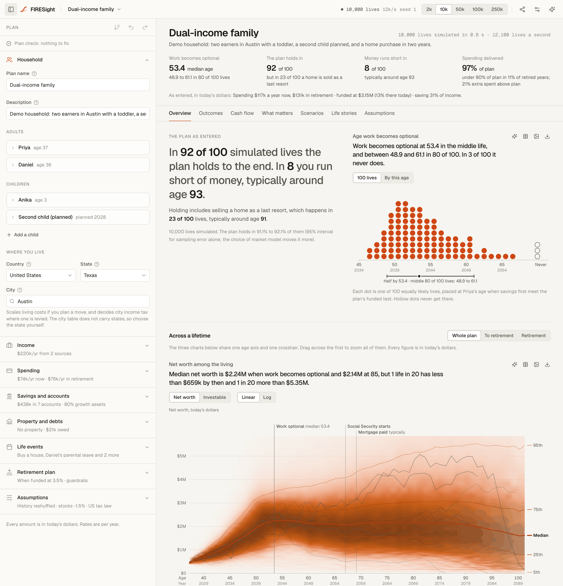
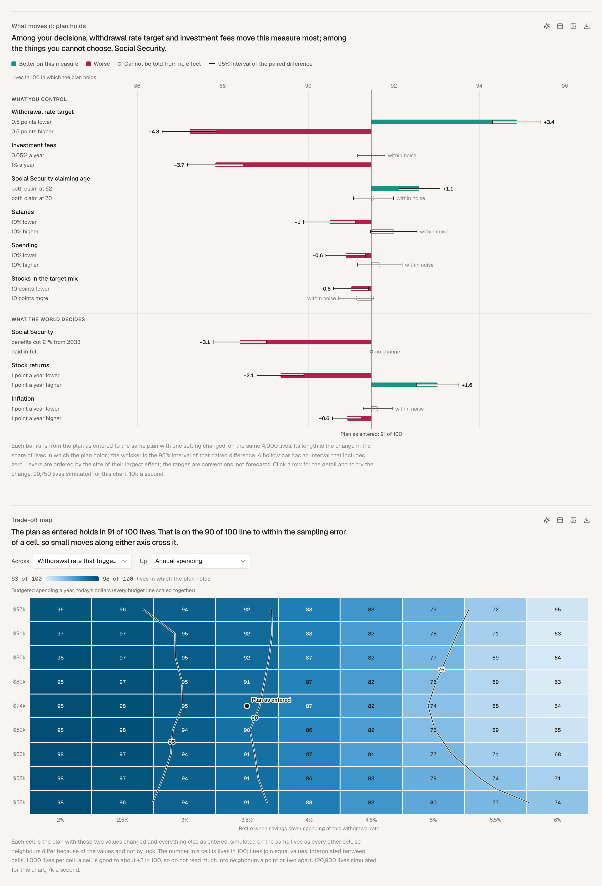
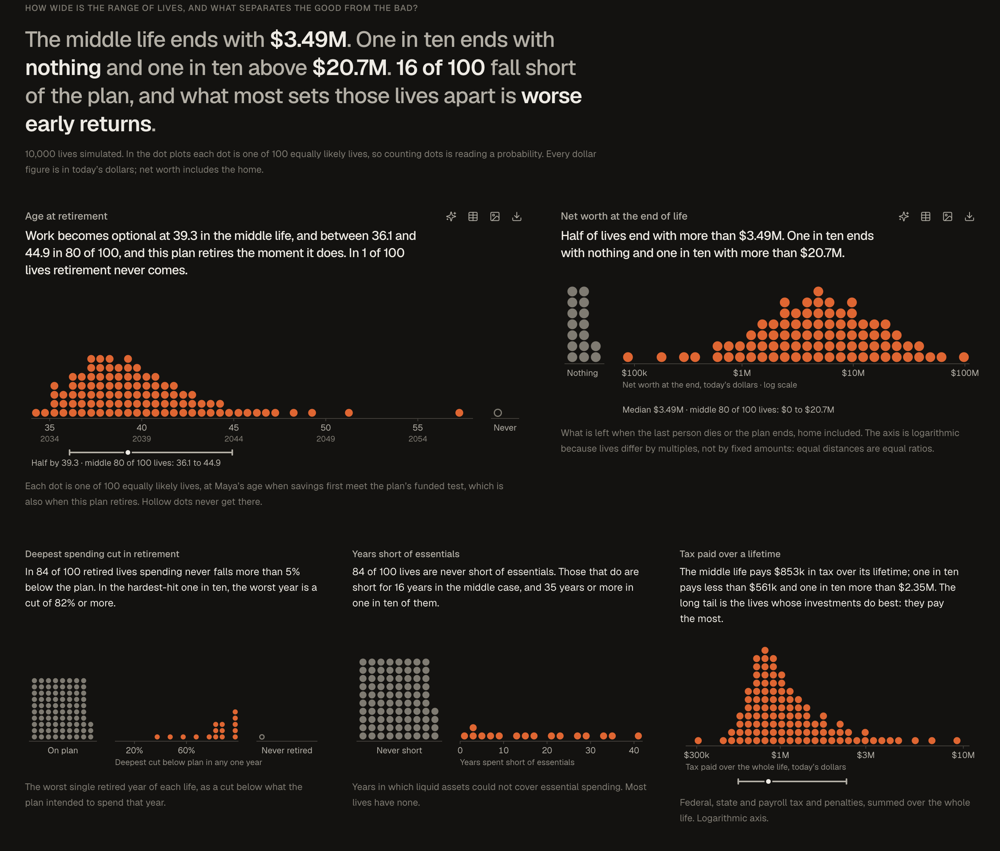
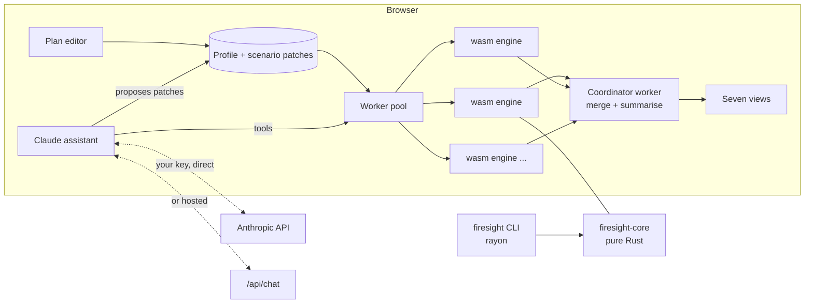

# FIRESight

**When can you stop working, and how sure is that?** FIRESight lives out your household's whole financial life, month by month, a hundred thousand times over, in your browser, in about six seconds. Then it shows you what happened in all of them.

[](https://github.com/joey12725/firesight-v2/actions/workflows/ci.yml)

[](LICENSE)

**[Try it: firesight-v2.vercel.app](https://firesight-v2.vercel.app)** · nothing to install, no account, your numbers never leave your browser.

<p align="center">
  
</p>

Most retirement calculators take one number for "market return", multiply, and hand you a date. FIRESight simulates the household instead: two careers with raises and layoffs, a 401(k) match, a mortgage, kids, real 2026 tax law, health insurance before Medicare, Social Security computed from your earnings, and how long you actually live. Markets, inflation, interest rates and home prices move together, the way they did in a century of history. Every simulated life is a complete ledger you can open and read.

This is the second version. The [first](https://github.com/joey12725/firesight) was a Python and Streamlit app that topped out at 200 runs. This one is a ground-up rewrite in Rust that runs 100,000 in a few seconds, and fixes a long list of things the old model got wrong ([about a hundred of them, written up](docs/v1-review.md)).

## What it does

- **A whole household, not a portfolio.** Two earners, children with childcare and college, homes and rentals, debts, life events with a probability and a fuzzy date ("we might inherit around 2040"). Seven kinds of income, five kinds of account.
- **An economy that hangs together.** Stocks, bonds, bills, inflation, mortgage rates, home prices and recessions are resampled jointly from 1,200 months of US history (1926 to 2026), so a 1970s-style stagflation hits your bonds, your raise and your grocery bill at once. Three other market models are one click away, including a straight replay of every historical start date.
- **Real tax law.** Federal brackets, capital gains stacking, the Social Security "tax torpedo", NIIT, FICA, the child credit, the SALT cap, 51 state systems and the big city taxes, all indexed to simulated inflation. Early retirees get the ACA premium credit, and the withdrawal planner steers around its cliff.
- **Retirement as it is actually done.** Roth conversion ladders, 72(t) payments, required distributions, tax-aware withdrawal ordering, and six spending rules from the literature (constant real, Guyton-Klinger guardrails, Vanguard dynamic, VPW and more).
- **Risks that are not the market.** Job loss that clusters in recessions, health costs, a long-term-care episode late in life, and a lifespan drawn from actuarial tables rather than assumed to end at 95.
- **Honest answers.** "The plan holds in 92 of 100 lives" comes with its sampling interval, how much spending was actually delivered, and how often holding meant selling the house. A plan that succeeds by cutting your spending 40% is not reported as a success and left at that.
- **Paired experiments.** Change a decision and the same hundred thousand futures are lived again with that one thing different, so the comparison measures your decision and not luck.
- **Claude, grounded.** An assistant that builds your plan from a description or a pay stub, runs the simulator to answer what-if questions, and cannot quote a number it did not get from the engine.

## The views

**What matters.** Every lever is tested on the same simulated lives and ranked by what it does to your result, split into what you control and what the world decides, with the uncertainty of each difference drawn on the bar. Below it, a map of two decisions at once, and a solver that finds the number you are looking for.

<p align="center"></p>

**Scenarios.** Because both versions of your plan live the same lives, the comparison can count the lives where the change is the difference between running short and not, and the ones where it backfires.

<p align="center"></p>

**Life stories.** Pick one life (an unlucky one, a middling one, one that ran short) and read it: the layoff during the crash, the Roth conversions, the year the guardrail cut spending, the tax return for 2041.

<p align="center"></p>

**Cash flow.** Where the money comes from and where it goes at every age, and a flow diagram for any single year.

<p align="center"></p>

There are three more: **Overview** (the screenshot at the top), **Outcomes** (how wide the range of lives is, and what separates the good ones from the bad), and **Assumptions** (what the model believes about the world, shown rather than buried in settings). Every chart has a sentence above it saying what it shows, a data table behind it, PNG and CSV export, and works in dark mode and on a phone.

<p align="center"></p>

## How fast

Measured on a 10-core Apple M-series laptop, simulating the bundled two-earner household (a 63-year plan, about 680 months per life):

| | Lives per second | 100,000 lives |
|---|---|---|
| Browser (9 web workers, wasm) | 17,500 | 5.7 s |
| CLI, 10 threads | 32,800 | 3.1 s |
| CLI, 1 thread | 5,700 | 17.7 s |

The first picture appears about 85 ms after you change a field, drawn from the first few hundred lives, and sharpens as the rest arrive. Charts hold 60 fps while a quarter of a million lives are running. A life allocates no memory while it is being simulated, and the same seed gives byte-identical results in the browser, on the command line, and across any number of threads.

More lives is not vanity. At 1,000 runs a 5% failure rate has a sampling interval of about ±1.4 points, which is enough to make two versions of a plan look different when they are not. At 100,000 it is ±0.14.

## Ask Claude

<p align="center"></p>

The assistant has twelve tools and all of them are the engine: read the plan, propose changes, run a simulation, try a scenario on the same paths, rank the levers, solve for a target, sweep a grid, open one life, explain a tax return. It proposes edits as cards you accept or decline, lists what it assumed against what you told it, and every answer carries a "based on" strip showing the runs behind it.

Bring your own Anthropic API key (it stays in your browser and goes only to Anthropic), or set `ANTHROPIC_API_KEY` on your own deployment to host it for visitors. Everything else works without it. Details and the privacy picture are in [docs/assistant.md](docs/assistant.md).

## Is the model any good?

It was built to be checked. Some of what has been:

- **The 4% rule falls out.** A retiree with $1M in a 60/40 portfolio spending $40,000 a year for 30 years, replayed from every start month since 1926, survives 96.0% of the time. The failures are exactly the 1965 to 1969 retirees, as in the published studies.
- **Money is conserved.** Three accounting identities are asserted every simulated month in test mode, across every market model and a household that exercises every feature. v1 quietly forgave shortfalls and charged the mortgage twice.
- **A closed-form check.** A riskless saver matches a spreadsheet recurrence to within $2 over ten years.
- **Scenarios are paired exactly.** Changing your spending leaves every market return, layoff and death date bit-identical. There are tests for it.
- **Seven independent audits.** Tax, ledger, retirement decisions, the economy, people, careers and housing, and performance were each reviewed by a separate auditor required to reproduce every claim. They found 3 critical and 20 major defects. All 23 were fixed, nearly all with a regression test.

The model is explained relationship by relationship, with its equations, its measured return distributions, and an unsparing list of what it leaves out, in **[docs/methodology.md](docs/methodology.md)**.

Three defaults are judgement calls that move headline numbers by several points, and you should know about them: US stock returns are haircut by 1.5 points a year against the historical record, crypto is assumed to have no expected real return, and a home is sold as a last resort before a household is counted as broke. All three are settings.

## Quickstart

You need [Rust](https://rustup.rs) (stable, with the `wasm32-unknown-unknown` target) and Node 22 or newer.

```bash
git clone https://github.com/joey12725/firesight-v2 && cd firesight-v2
rustup target add wasm32-unknown-unknown

cd web
npm install
npm run wasm       # compile the engine to WebAssembly
npm run schema     # generate TypeScript types from the Rust profile schema
npm run dev
```

Open <http://localhost:5173> and pick a demo household.

### From the command line

```bash
cargo build --release -p firesight-cli
alias firesight=./target/release/firesight

firesight run examples/dual-income-family.json --paths 100000
```

```
Dual-income family (start 2026-11, seed 1)
paths                  100000
success rate           91.7%  (95% interval 91.5% to 91.9%)
depletion risk         8.3%  (median age when it happens 92.6)
financially independent 96.7% of paths; age p10 49.0 / p50 53.4 / p90 61.2
retirement age         p10 50.0 / p50 53.4 / p90 61.2
spending delivered     97.0% of plan on average; 43.5% of retired paths had a year below 90%
terminal net worth     p10 $133,167 / p50 $1,761,075 / p90 $4,071,800
lifetime tax (median)  $962,458
failed paths, first cause: Health 89.3%, MarketSequence 6.1%, JobLoss 1.9%, Overspending 1.4%
32802 paths/s on 10 thread(s) (3.05 s)
```

```bash
firesight trace   examples/dual-income-family.json --quantile 0.1 --by terminal_net_worth   # read an unlucky life
firesight compare examples/dual-income-family.json my-change.json                           # same futures, one change
firesight solve   examples/dual-income-family.json --lever /retirement/trigger/withdrawal_rate \
                  --target-success 0.95 --lo 0.02 --hi 0.06                                 # find the number
firesight migrate examples/v1/early-career-saver.json                                       # bring a v1 profile forward
firesight schema                                                                            # the profile format
```

A profile is one JSON file. A scenario is a small patch against it: `[{"op": "set", "path": "/incomes/@priya_job/kind/salary", "value": 165000}]`.

## How it fits together



- **`crates/firesight-core`** is the whole model: pure Rust, no I/O, no threads, no clock. The scenario generator, tax law, careers, housing, health, Social Security, accounts, withdrawal planning, the monthly loop, and mergeable statistics.
- **`crates/firesight-wasm`** wraps it for the browser. Each worker simulates chunks of lives and returns a compact accumulator (histograms, counts, per-life scalars); a coordinator merges them in any order. No life's time series is ever stored, because any life can be re-simulated alone from its seed in a fraction of a millisecond.
- **`crates/firesight-cli`** is the same engine on native threads.
- **`web/`** is React and TypeScript, with charts drawn by hand on canvas and SVG. TypeScript types and the assistant's tool schemas are generated from the Rust types, so the profile format has one source of truth.
- **`api/chat.ts`** is the only server code: an optional streaming proxy to Claude, locked to FIRESight's own prompt and tools.
- **`data/`** holds the sourced parameter sets (2026 federal and state tax law, the market history, SSA life tables, health and care costs, a cost-of-living index for 4,400 cities), and **`tools/`** the scripts that rebuild them from public sources.

There is no backend and no database. Plans live in your browser, export as JSON, and share as a link that encodes the plan in the URL fragment.

The design contract is in [docs/architecture.md](docs/architecture.md) and the engine's output format in [docs/engine-output.md](docs/engine-output.md).

## Deploying your own

The repo deploys to [Vercel](https://vercel.com) as is: import it and press deploy. `vercel.json` builds the engine to wasm on Vercel's build image (it installs Rust on the first build and caches it), serves the static app, and exposes `/api/chat`.

To host the assistant for your visitors, set these on the project:

| Variable | Purpose |
|---|---|
| `ANTHROPIC_API_KEY` | Turns on hosted mode |
| `FIRESIGHT_ACCESS_CODE` | Optional shared code visitors must enter |
| `FIRESIGHT_RATE_PER_MINUTE`, `FIRESIGHT_RATE_PER_DAY` | Per-IP limits (default 30 and 600) |

Put a spend limit on the key. The proxy checks are a deterrent, not a wall.

## Development

```bash
cargo fmt --all --check
cargo clippy --workspace --all-targets -- -D warnings
cargo test --workspace --release          # 423 tests: unit, conservation, determinism, golden results, audits

cd web
npm run typecheck && npm run lint
npm run test                              # 282 tests, most against the real wasm engine
npm run build
npm run smoke                             # Playwright against a running preview

tools/bench-check.sh                      # fails on a throughput regression over 25%
```

A change to the model that moves results has to update the golden digests on purpose: `FIRESIGHT_UPDATE_GOLDEN=1 cargo test -p firesight-core --test sim_golden`.

## What it does not know

US households only. No divorce, no disability, no 529 plans, no AMT, no municipal bonds, no annuitisation decision, no state estate taxes. A foreign move is a flat tax rate and a cost-of-living factor. Market history is one country that happened to do well. The full list, with how much each omission matters, is [section 17 of the methodology](docs/methodology.md#17-known-limitations-and-deliberate-omissions).

FIRESight is a planning tool. It is not financial advice, and the author is not your adviser.

## License

[MIT](LICENSE). Market data comes from the Kenneth French Data Library, FRED, Robert Shiller and FHFA; see [data/history/README.md](data/history/README.md) for sources and terms.

---

Built by [Joey Hersh](https://github.com/joey12725).
