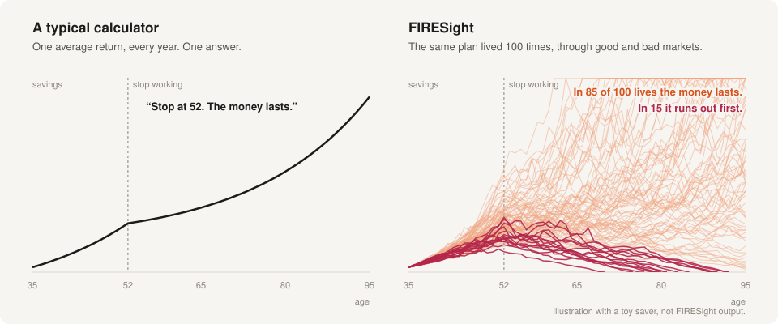

# New to this? A primer

You don't need to know any personal finance to use FIRESight or read its code. This page covers the ideas it is built on, in about ten minutes. It starts with the movement the name comes from, explains why a single forecast misleads, shows how to read FIRESight's answers, and ends with a [glossary](#glossary) of every term the app and the docs use.

**Contents:** [What FIRE is](#what-fire-is) · [The arithmetic](#the-arithmetic-the-4-rule) · [Why one forecast is not enough](#why-one-forecast-is-not-enough) · [Monte Carlo, simply](#monte-carlo-simply) · [Reading FIRESight's answer](#reading-firesights-answer) · [The seven views](#the-seven-views) · [Glossary](#glossary)

## What FIRE is

**FIRE** stands for *Financial Independence, Retire Early*. People in the movement save an unusually large share of their income (often 30 to 70%) and invest it. They keep going until the investments can pay for their life indefinitely. From then on a job is a choice, not a necessity. Most people who reach that point keep doing some kind of work. "Retire" here means the work no longer has to pay the bills.

The questions everyone in the movement eventually asks are:

1. **How much is enough?** How big do my savings have to be before I can live off them?
2. **When will I get there?** At my current income, spending and savings rate, at what age?
3. **How sure is that?** What happens if the market crashes the year after I quit, or I live to 100?

Most tools answer the first two and skip the third. FIRESight is built around the third. Its tagline, "when can work become optional, and how sure is that?", is those three questions in one sentence.

There are named flavours you will meet online: *lean FIRE* (a frugal budget), *fat FIRE* (a generous one), *coast FIRE* (enough saved that, with no more contributions, growth alone gets you there by a normal retirement age) and *barista FIRE* (part-time work covers part of the bills). FIRESight doesn't need you to pick one. You describe your household and the plan, and it reports what follows, including your coast age.

## The arithmetic: the 4% rule

The movement's rule of thumb comes from a 1994 study by William Bengen and the 1998 "Trinity study" that followed it. Retirees who withdrew **4% of their portfolio in the first year**, then raised the dollar amount with inflation each year, almost always had money left after **30 years**, across every historical start date the studies tested.

Turned around, that gives the famous target. **Save 25 times what you spend in a year.** Spending $60,000 a year means aiming for $1.5 million.

The rule is a reasonable first sketch with several known gaps:

- **It was measured over 30 years.** Someone who stops at 45 might need the money for 50. Over longer horizons 4% fails noticeably more often. FIRESight's own [validation](methodology.md#15-validation) reproduces the 30-year result, and its [methodology](methodology.md#11-when-retirement-happens) shows how the failure rate grows with a longer retirement.
- **It ignores tax.** A withdrawal from a traditional 401(k) is taxed as income, while a Roth withdrawal is not. The order you draw on accounts changes how long they last.
- **It ignores the rest of life.** Health insurance before Medicare at 65, a mortgage that ends, children's college, Social Security starting at 67, a job lost in a recession while you're still saving.
- **It assumes you never adjust.** Real retirees cut back in bad years. Rules that do this deliberately, such as *guardrails*, let a portfolio last longer at a higher starting rate.

FIRESight treats the withdrawal rate as a setting (4% by default; the demo households use a more cautious 3.5%) and models everything on that list.

## Why one forecast is not enough

A typical calculator assumes your investments earn the same average return every year and draws one line. Real markets give that average in a jumbled order. The order matters most around the year you stop working. A crash early in retirement forces you to sell low to pay the bills, and the money you sold never recovers. This is called **sequence-of-returns risk**.

  

Both panels show the same toy saver with the same 5% average return. On the left the money lasts comfortably. On the right the returns arrive in 100 different orders. In 15 of them the saver runs out, all of them lives where the bad years came early. The average answer said nothing about that risk.

## Monte Carlo, simply

A **Monte Carlo simulation** answers "how sure?" by brute force. Instead of predicting one future, it generates thousands of plausible ones and counts what happens across them. The name comes from the casino. Each run is a roll of the dice.

FIRESight calls each run a **life**. In one life the household works, gets raises, maybe gets laid off in a recession, has children, buys a house, pays taxes, retires when the plan says it can afford to, draws down savings, claims Social Security, and eventually dies at an age drawn from actuarial tables. The markets in that life are stitched together from real months of US history since 1926. Stocks, bonds, inflation, interest rates and house prices move together the way they actually did.

Then it lives the plan again with different dice, 100,000 times in a few seconds.

Two things follow from that:

- **Answers are counts, not promises.** "The plan holds in 92 of 100 lives" means that across all the simulated futures, 92% ended with the household never running out of money. It doesn't mean you have a 92% chance in any deep sense. The model is a model, and the [methodology](methodology.md) says where it is likely wrong.
- **More lives give a sharper count.** With 1,000 lives, 92% is uncertain by about ±1.7 points just from which dice came up. With 100,000 it is about ±0.17. FIRESight prints that interval next to the number.

## Reading FIRESight's answer

Open a demo household and the first thing you see is a strip of four numbers:

| On screen | What it means |
|---|---|
| **Work becomes optional: 53.4 median age** | The age at which savings first pass the "funded" test (enough to cover planned spending at the chosen withdrawal rate). 53.4 is the middle life. Half get there sooner, half later. The line below gives the range for the middle 80 of 100 lives. |
| **The plan holds in: 92 of 100** | In 92 of every 100 simulated lives the household never runs out of money. If it says "but in 23 of 100 a home is sold as a last resort", some of those 92 only held because the house was sold. |
| **Money runs short in: 8 of 100** | The other side of the previous number, and the typical age when it happens. Running short at 93 is a different problem from running short at 60. |
| **Spending delivered: 97% of plan** | A plan can "hold" by cutting spending to the bone in bad years. This reports how much of the planned lifestyle was actually paid for. |

Below that, every chart has a plain sentence above it saying what it shows ("Median net worth is $2.24M when work becomes optional…"). Read the sentence first. The chart is there to check it.

Most charts are **dot plots of 100 dots**, each dot one equally likely life. You can read a probability by counting dots, with no statistics needed.

## The seven views

| View | The question it answers |
|---|---|
| **Overview** | When does work become optional, and how sure is that? |
| **Outcomes** | How wide is the range of lives, and what separates the good ones from the bad? |
| **Cash flow** | Where does the money come from and go, at every age? |
| **What matters** | Which decisions move my result most, and which risks are out of my hands? |
| **Scenarios** | If I change one thing, what difference does it make on the same set of futures? |
| **Life stories** | What does one of these lives actually look like, year by year? |
| **Assumptions** | What does the model believe about markets, inflation, lifespans and taxes? |

## Glossary

Terms are grouped by topic. Where FIRESight uses a word in a specific sense, that sense comes first.

### FIRESight's own terms

- **Life (path).** One complete simulated future for the household, month by month. "Path" is the same thing in the code and the methodology.
- **Plan holds / success.** A life in which the household reached retirement, never ran out of money, and left at least the inheritance it aimed to (zero by default).
- **Runs short / depleted.** Nothing liquid is left, every optional expense has been cut, any home has been sold, and an essential bill still can't be paid.
- **Funded / work becomes optional.** Savings, net of debts and of child costs still to come, cover the retirement budget plus tax at the chosen withdrawal rate, counting income such as Social Security that will start later. By default each simulated life retires the month it first passes this test.
- **Spending delivered.** Spending actually paid for, as a share of the plan's budget.
- **Lever.** A setting you can change, such as spending, withdrawal rate, salary, claiming age or stock share. *What matters* tests each one.
- **Paired scenario.** A variant of your plan run on exactly the same simulated futures (same markets, layoffs and death dates), so the difference between the two is caused by your change and not by luck.
- **Today's dollars.** Every figure is adjusted for inflation back to the plan's start, so $1M at 70 means what $1M buys now. Economists call these *real* dollars. *Nominal* dollars are the face value at the time.
- **Seed.** The number that fixes the random dice. The same plan and seed give byte-identical results anywhere.

### Statistics

- **Median.** The middle value: half the lives are above it and half below.
- **Percentile (p10, p90).** The value that 10% (or 90%) of lives fall below. "p10 to p90" is the range of the middle 80%.
- **95% interval.** How far a figure could move just from the luck of which lives were simulated. More lives make it narrower.
- **Block bootstrap.** FIRESight's default way of generating markets. Real months of history are copied in runs of about five years, in shuffled order, so things that really happened together stay together.
- **Equity haircut.** By default FIRESight assumes US stocks return 1.5 points a year less than they did over 1926 to 2026, because that century was unusually good for one country. It is a setting.

### Saving and accounts (US)

- **401(k) / 403(b).** Workplace retirement accounts. Contributions are usually *traditional*: tax-deductible now, taxed as income when withdrawn.
- **Employer match.** Money the employer adds to your 401(k) when you contribute, for example 50% of the first 6% of salary.
- **Roth (IRA or 401(k)).** Contributions are taxed now. Growth and withdrawals in retirement are tax-free.
- **IRA.** An individual retirement account you open yourself, in traditional or Roth form.
- **HSA.** Health savings account. It is tax-deductible going in and tax-free coming out for medical costs.
- **Taxable (brokerage) account.** An ordinary investment account. You pay tax on dividends each year and on gains when you sell.
- **Savings rate.** The share of income saved rather than spent or taxed.
- **Investable assets vs net worth.** Investable assets are what you could sell to pay for life: accounts and cash. Net worth also includes home equity and subtracts debts.

### Retiring early

- **Withdrawal rate.** The share of the portfolio withdrawn in a year. The 4% rule is a 4% first-year rate. FIRESight's "withdrawal rate that counts as funded" is the rate used to decide when you have enough. A lower rate is safer and needs a bigger pile.
- **Sequence-of-returns risk.** The danger that bad returns arrive just as you start withdrawing. See [above](#why-one-forecast-is-not-enough).
- **Spending rule.** How spending changes once retired. The options are *constant real* (the same inflation-adjusted amount whatever happens), *guardrails* (Guyton-Klinger: cut 10% when the withdrawal rate drifts 20% too high, raise it when it drifts 20% too low), *Vanguard dynamic*, *floor and ceiling*, *percent of portfolio*, and *VPW* (variable percentage withdrawal).
- **Early-withdrawal penalty.** Taking money out of a retirement account before age 59½ usually costs a 10% penalty on top of tax. Early retirees work around it in three ways:
  - **Roth conversion ladder.** Move money from a traditional account to a Roth each year, paying income tax. Five years later that converted amount can be withdrawn penalty-free.
  - **72(t) / SEPP.** "Substantially equal periodic payments" from an IRA, penalty-free if kept up for at least five years or until 59½.
  - **Rule of 55.** Leave a job in or after the year you turn 55 and you can draw that employer's 401(k) without penalty.
- **RMD (required minimum distribution).** From age 73 or 75 (it depends on birth year) the IRS requires a minimum yearly withdrawal from traditional accounts.
- **Coast age.** The age at which today's savings, with no further contributions, would grow enough to pass the funded test by the planned retirement age.
- **Bridge.** The years between stopping work and the start of income such as Social Security, which savings must cover alone.

### Tax (US, 2026 law)

- **Tax brackets / marginal rate.** Income is taxed in slices at rising rates. The marginal rate is the rate on the next dollar.
- **Capital gains.** Profit on selling an investment. Gains on investments held over a year are taxed at 0%, 15% or 20%, depending on total income.
- **FICA.** Social Security and Medicare payroll tax on wages.
- **NIIT.** A 3.8% surtax on investment income above a threshold.
- **SALT cap.** The limit on deducting state and local taxes from federal income.
- **Tax torpedo.** A band of income in which each extra dollar also makes more of your Social Security taxable, so the effective marginal rate jumps.
- **Child tax credit.** A per-child reduction in federal tax.

### Health and old age

- **ACA marketplace.** Health insurance bought on the Affordable Care Act exchanges, the usual cover for early retirees before Medicare.
- **Premium tax credit / subsidy cliff.** The ACA subsidy shrinks as income rises. Under 2026 law it stops entirely above 400% of the poverty line. FIRESight's withdrawal planner keeps taxable income under that cliff when it can.
- **Medicare.** Federal health insurance from 65.
- **Long-term care.** Help with daily living late in life, such as a care home or home aides. It is expensive, mostly not covered by Medicare, and FIRESight models it as a possible episode.
- **Social Security.** The US public pension. The benefit depends on your 35 highest-earning years and the age you claim. Claiming at 62 cuts the benefit for life, and waiting to 70 raises it. FIRESight computes it from the simulated earnings and can model a benefit cut from 2033, when the trust fund is projected to run low.
- **Actuarial (life) tables.** The Social Security Administration's tables of the chance of dying at each age. FIRESight draws each life's death age from them instead of assuming everyone lives to 95.

## Where next

- **[Try it](https://firesight-v2.vercel.app)**: open a demo household and change something.
- **[methodology.md](methodology.md)**: how every part of the model works, with its equations, checks and known gaps.
- **[architecture.md](architecture.md)**: how the code is put together, for contributors.

FIRESight is a planning tool, not financial advice.
